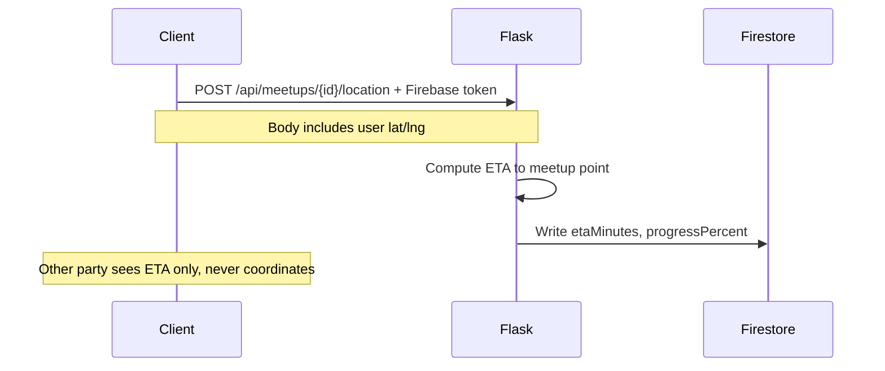

# FirmShake API Architecture

This repo is the **server** half of FirmShake. The client is the Ionic Vue app in the **`firmshake`** repo.

## Responsibilities

Flask handles what must not live in the client:

- **Image upload and serving** (`storage/images/`)
- **Location ETA computation** — raw coordinates stay server-side; clients only receive ETA and progress
- **Payment webhooks and penalty logic** (Stripe, later milestones)
- **Admin operations** for curated communities

Default dev URL: `http://localhost:5001`

## Endpoints

### Current

```
GET  /health
POST /api/images          # multipart file upload
GET  /api/images/<name>   # serve stored image
POST /api/meetups/{id}/location   # authenticated; compute ETA
POST /api/notifications/push    # authenticated; send FCM to recipient
```

### Planned

```
POST /api/meetups/{id}/location   # authenticated; compute ETA
POST /api/webhooks/stripe         # deposits and penalties
POST /api/admin/communities       # seed admin-curated groups
```

## Location privacy



## Security

- Protected routes verify `Authorization: Bearer <Firebase ID token>`
- **Image upload and download** require a valid Firebase token; the API checks community membership via Firestore before serving bytes
- Images are stored in a **private** GCS bucket (or local disk in dev); clients never receive permanent public object URLs
- Penalty and payout logic runs only in webhook handlers — never in the client

## Deployment

| Phase | Hosting |
|---|---|
| **Now** | Your Mac; tunnel (ngrok) for mobile dev |
| **Later** | Small VPS, Railway, or Fly.io |

## Related documentation

Client setup, Firebase, and full product architecture are documented in the **firmshake** app repo.
